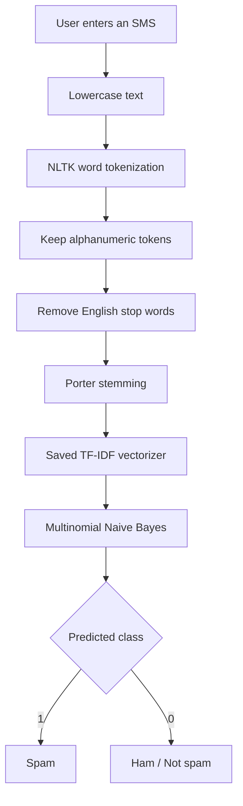

# SMS Spam Classifier

[](https://spam-classifier1.streamlit.app/)
[](https://www.python.org/)
[](https://scikit-learn.org/)

A machine-learning web application that classifies an SMS/text message as **spam** or **ham (not spam)**. The project uses a trained **Multinomial Naive Bayes** classifier with **TF-IDF** text features and an NLTK preprocessing pipeline.

<blockquote>
<strong>Try the live application:</strong> https://spam-classifier1.streamlit.app/
</blockquote>

## Project overview

The model learns statistical patterns in labelled SMS messages. At inference time, the application applies the same text preprocessing used during training, transforms the message with the saved TF-IDF vocabulary, and passes the resulting feature vector to the trained classifier.

### Prediction pipeline



## Model and preprocessing

| Component | Implementation |
|---|---|
| Task | Binary text classification |
| Classifier | Multinomial Naive Bayes |
| Feature extraction | TF-IDF |
| Vocabulary limit | 3,000 features |
| Tokenization | NLTK word tokenizer |
| Stop-word removal | NLTK English stop words |
| Stemming | Porter Stemmer |
| Interface | Streamlit |

The model and vectorizer are loaded from the committed `model.pkl` and `vectorizer.pkl` artifacts. **Both artifacts must be used together**: the vectorizer defines the feature mapping expected by the trained model.

## Repository structure

```text
Spam_Classifier/
├── app.py                       # Streamlit entry point
├── spam_classifier/
│   ├── __init__.py
│   ├── preprocessing.py          # Text normalization and NLTK resources
│   └── inference.py              # Artifact loading and prediction
├── docs/
│   ├── MODEL_CARD.md             # Model scope, intended use and limitations
│   └── PROJECT_STRUCTURE.md      # Architecture and maintenance notes
├── scripts/
│   └── verify_artifacts.py       # Local artifact/preprocessing smoke check
├── .streamlit/
│   └── config.toml               # Streamlit theme and server settings
├── .gitignore
├── requirements.txt
├── model.pkl                     # Trained MultinomialNB model
├── vectorizer.pkl                # Fitted TF-IDF vectorizer
├── spam.csv                      # Source SMS dataset
└── Spam Classifier.ipynb         # Original experimentation notebook
```

## Run locally

### 1. Clone the repository

```bash
git clone https://github.com/CodeWithRjUdit/Spam_Classifier.git
cd Spam_Classifier
```

### 2. Create and activate a virtual environment

Python 3.11 is recommended for the pinned dependency set.

Windows PowerShell:

```powershell
py -3.11 -m venv .venv
.venv\Scripts\Activate.ps1
```

macOS/Linux:

```bash
python3.11 -m venv .venv
source .venv/bin/activate
```

### 3. Install dependencies

```bash
python -m pip install --upgrade pip
pip install -r requirements.txt
```

### 4. Run the application

```bash
streamlit run app.py
```

Open the local URL printed by Streamlit (usually http://localhost:8501).

### 5. Verify model artifacts (optional)

```bash
python scripts/verify_artifacts.py
```

## Deployment

The app is hosted on Streamlit Community Cloud:

- **Repository:** `CodeWithRjUdit/Spam_Classifier`
- **Branch:** `main`
- **Main file:** `app.py`
- **Python:** 3.11
- **Live URL:** https://spam-classifier1.streamlit.app/

The root-level `app.py` is intentionally retained as the Streamlit entry point. Changes pushed to the connected deployment branch are picked up by Streamlit Community Cloud.

## Dataset and experiment

The repository includes `spam.csv` and the original Jupyter notebook, `Spam Classifier.ipynb`, documenting the exploratory analysis, preprocessing, TF-IDF feature extraction, model comparison, and final artifact export.

The notebook's final saved classifier is Multinomial Naive Bayes. Consult the notebook for the actual experiment outputs; this README intentionally does not claim a performance score that is not explicitly documented here.

## Limitations and responsible use

- This is an educational demonstration, not a production-grade spam filtering service.
- Predictions are based on patterns learned from the training dataset and may not generalize to every language, region, message style, or newly emerging scam.
- A "Not spam" prediction does **not** establish that a message, sender, link, or attachment is safe.
- Do not submit sensitive personal information.
- Pickle artifacts should only be loaded from a trusted source because pickle deserialization can execute code.

See [docs/MODEL_CARD.md](docs/MODEL_CARD.md) for intended use, risks, and limitations.

## Future improvements

- Add a reproducible training script and data validation.
- Add automated tests for preprocessing and prediction.
- Record evaluation metrics, including precision, recall, F1-score, and a confusion matrix, from a reproducible held-out test set.
- Evaluate performance on recent and multilingual spam examples.
- Add model/version metadata and artifact checksums.

## Author

**RJ Udit Nath**

- GitHub: [CodeWithRjUdit](https://github.com/CodeWithRjUdit)
- Project repository: [Spam_Classifier](https://github.com/CodeWithRjUdit/Spam_Classifier)
- Live application: [SMS Spam Classifier](https://spam-classifier1.streamlit.app/)
